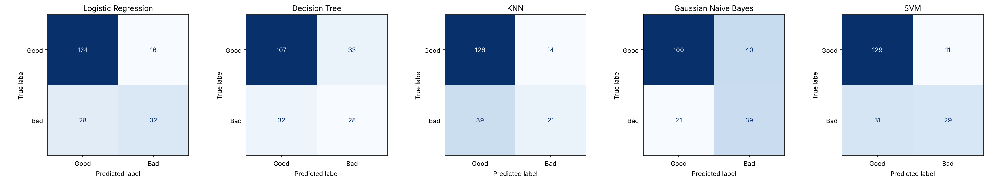
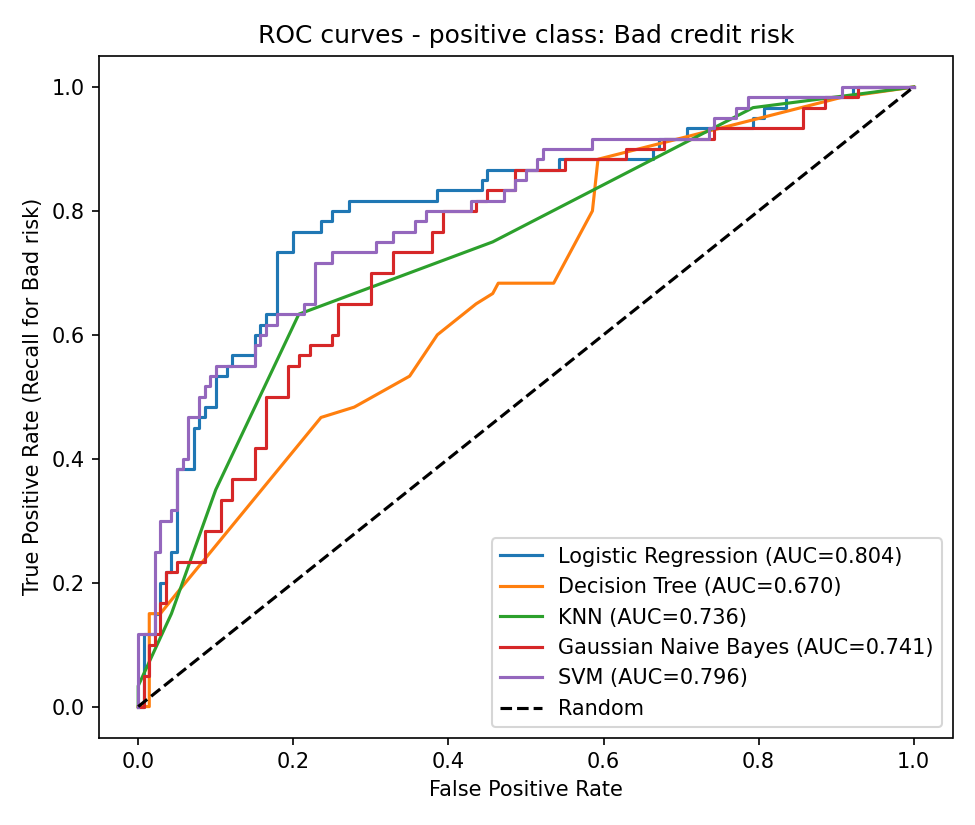

# German Credit Risk Classification (Statlog German Credit Data)

Machine Learning Assignment 2: five classification models, evaluation with six metrics, and a Streamlit web application.

## a. Problem statement

Credit risk assessment is an important task in the financial and banking industry, as financial institutions need to evaluate the creditworthiness of individuals before granting loans or other forms of credit. Incorrect assessment of an applicant's creditworthiness can result in financial losses due to loan defaults or missed opportunities to provide credit to eligible applicants.

Traditional credit assessment processes rely on the analysis of an applicant's financial background, credit history, employment status, and other personal and financial characteristics. Evaluating multiple attributes simultaneously can be complex and may benefit from data-driven predictive approaches.

The objective of this project is to develop and evaluate supervised machine learning classification models to predict whether an individual represents a good or bad credit risk, based on a set of financial, personal, and credit-related attributes.

For this purpose, the Statlog (German Credit Data) dataset from the UCI Machine Learning Repository is used. The dataset contains information about 1,000 credit applicants, represented by 20 independent input attributes, with a binary target variable indicating the applicant's credit risk category.

Five supervised machine learning classification algorithms are implemented and evaluated:

1. Logistic Regression
2. Decision Tree Classifier
3. K-Nearest Neighbors (KNN) Classifier
4. Gaussian Naive Bayes Classifier
5. Support Vector Machine (SVM)

The models are trained and evaluated using a consistent data preprocessing methodology and a common stratified 80:20 training and testing dataset split to ensure a fair comparison.

The predictive performance of each classifier is assessed using the following evaluation metrics:

- Accuracy
- Area Under the Receiver Operating Characteristic Curve (AUC)
- Precision
- Recall
- F1-Score
- Matthews Correlation Coefficient (MCC)

**Positive class:** Bad credit risk (original label 2) is treated as the positive class, because failing to detect a bad applicant is usually the more costly mistake. Precision, recall and F1-score are therefore calculated for identifying bad-risk applicants.

The primary objective is to compare the predictive performance of the five classification algorithms, identify their respective strengths and limitations, and determine which model provides the most suitable overall performance for the given credit risk classification problem.

The project follows a reproducible machine learning classification workflow, using fixed random states, preprocessing pipelines that avoid data leakage, saved trained models, and an interactive Streamlit application for evaluation. It is an academic experiment on a historical dataset and is not intended for real-world credit approval decisions.

## b. Dataset description

| Item | Detail |
|---|---|
| Name | Statlog (German Credit Data) |
| Source | UCI Machine Learning Repository: https://archive.ics.uci.edu/dataset/144/statlog+german+credit+data |
| File used | Original `german.data` (not `german.data-numeric`) |
| Instances | 1,000 |
| Input features | 20 (7 numerical, 13 categorical) |
| Target | Credit risk: original label 1 = Good, 2 = Bad |
| Class balance | 700 Good (70%), 300 Bad (30%) |
| Missing values | None |
| Duplicate rows | None |

The raw file has no header row and stores categorical values as codes (for example `A11`, `A34`). Column names were assigned in the order given in the UCI documentation (see `src/preprocessing.py`).

### Features

| # | Feature name (in code) | Type | Meaning |
|---|---|---|---|
| 1 | status_checking_account | Categorical | Status of existing checking account |
| 2 | duration_months | Numerical | Loan duration in months |
| 3 | credit_history | Categorical | Past credit history |
| 4 | purpose | Categorical | Purpose of the loan |
| 5 | credit_amount | Numerical | Credit amount |
| 6 | savings_account | Categorical | Savings account / bonds |
| 7 | employment_since | Categorical | Present employment duration |
| 8 | installment_rate | Numerical | Instalment rate as a percentage of disposable income (1 to 4) |
| 9 | personal_status_sex | Categorical | Personal status and sex |
| 10 | other_debtors | Categorical | Other debtors or guarantors |
| 11 | residence_since | Numerical | Years at present residence (coded 1 to 4) |
| 12 | property | Categorical | Property owned |
| 13 | age_years | Numerical | Age in years |
| 14 | other_installment_plans | Categorical | Other instalment plans |
| 15 | housing | Categorical | Housing situation |
| 16 | existing_credits | Numerical | Number of existing credits at this bank |
| 17 | job | Categorical | Job category |
| 18 | people_liable | Numerical | Number of people liable to provide maintenance |
| 19 | telephone | Categorical | Telephone registered |
| 20 | foreign_worker | Categorical | Foreign worker status |

### Data-quality observations (from actual inspection)

- No missing values and no duplicate rows.
- The target is imbalanced (70% / 30%). A model that always predicts "Good" would reach 70% accuracy, so accuracy alone is misleading.
- `credit_amount` is right-skewed (skewness about 1.95).
- Four numerical columns (`installment_rate`, `residence_since`, `existing_credits`, `people_liable`) take only a few distinct values; they are treated as numbers and scaled.

## Data preprocessing and methodology

1. **Target encoding:** Bad credit risk (original label 2) is encoded as **1** (positive class) and Good (original label 1) as **0**.
2. **Train-test split:** stratified 80:20 split with `random_state=42`, giving 800 training rows and 200 test rows. The test set contains 60 bad and 140 good applicants (30% bad, the same as the full data).
3. **Preprocessing** (scikit-learn `ColumnTransformer` inside a `Pipeline`):
   - Numerical features: `StandardScaler` (mean 0, standard deviation 1).
   - Categorical features: `OneHotEncoder(handle_unknown="ignore")`.
   - The result is 61 model input columns (7 numerical + 54 one-hot).
4. **No data leakage:** the preprocessing is fitted on the training data only, because it sits inside each pipeline. For example, the scaler's mean for `credit_amount` equals the training mean (3189.59), not the full-data mean (3271.26).
5. **Same split and preprocessing for all five models.** Each saved model is a complete pipeline (preprocessing + classifier), so the Streamlit app can feed raw rows directly and never refits anything.

## Models used

All models use the documented settings below. **No hyperparameter tuning was performed**, so no model is claimed to be optimised.

| Model | Settings |
|---|---|
| Logistic Regression | `max_iter=1000`, `C=1.0`, `random_state=42` |
| Decision Tree | `max_depth=5`, `min_samples_leaf=5`, `random_state=42` |
| K-Nearest Neighbours | `n_neighbors=7` |
| Gaussian Naive Bayes | default settings |
| Support Vector Machine | RBF kernel, `C=1.0`, `gamma="scale"`, `probability=True`, `random_state=42` |

- **Logistic Regression** calculates a weighted sum of the features and converts it into a probability of default.
- **Decision Tree** learns a sequence of if-then splits; its depth was limited to reduce overfitting.
- **KNN** classifies an applicant by a vote of the 7 most similar training applicants; it depends on distances, so scaling matters.
- **Gaussian Naive Bayes** applies Bayes' rule and assumes the features are independent and normally distributed. These assumptions fit one-hot columns poorly.
- **SVM** finds a maximum-margin boundary using an RBF kernel. `probability=True` is set so AUC can be computed from probabilities.

## Evaluation metrics

All metrics are computed on the same held-out test set (200 rows), with **Bad credit risk as the positive class**. AUC is computed from the predicted probability of Bad risk (`predict_proba[:, 1]`); the class order of every model was verified to be `[0, 1]`.

| Metric | Meaning |
|---|---|
| Accuracy | Share of all predictions that are correct |
| AUC | How well the model ranks bad applicants above good ones, independent of a threshold (0.5 = random, 1 = perfect) |
| Precision | Of applicants flagged as bad, the share that really are bad |
| Recall | Of all truly bad applicants, the share that were caught |
| F1-score | Harmonic mean of precision and recall |
| MCC | Matthews Correlation Coefficient: a balanced score from -1 to 1 that stays reliable with imbalanced classes |

## d. Model comparison (actual results on the test set)

| ML Model Name | Accuracy | AUC | Precision | Recall | F1 | MCC |
|---|---|---|---|---|---|---|
| Logistic Regression | 0.7800 | 0.8040 | 0.6667 | 0.5333 | 0.5926 | 0.4496 |
| Decision Tree | 0.6750 | 0.6705 | 0.4590 | 0.4667 | 0.4628 | 0.2299 |
| KNN | 0.7350 | 0.7357 | 0.6000 | 0.3500 | 0.4421 | 0.3015 |
| Naive Bayes (Gaussian) | 0.6950 | 0.7411 | 0.4937 | 0.6500 | 0.5612 | 0.3415 |
| Support Vector Machine | 0.7900 | 0.7960 | 0.7250 | 0.4833 | 0.5800 | 0.4637 |

Confusion-matrix counts on the 200 test rows (positive class = Bad; 60 bad applicants in total):

| Model | True Good (TN) | False Bad (FP) | Missed Bad (FN) | Caught Bad (TP) |
|---|---|---|---|---|
| Logistic Regression | 124 | 16 | 28 | 32 |
| Decision Tree | 107 | 33 | 32 | 28 |
| KNN | 126 | 14 | 39 | 21 |
| Naive Bayes (Gaussian) | 100 | 40 | 21 | 39 |
| Support Vector Machine | 129 | 11 | 31 | 29 |

Charts generated by the training run: `outputs/confusion_matrices.png`, `outputs/roc_curves.png`, `outputs/metric_comparison.png`.

### Observations on each model

| ML Model Name | Observation about model performance |
|---|---|
| Logistic Regression | Highest AUC (0.8040) and highest F1 (0.5926), with the second-best accuracy (0.780) and MCC (0.4496). It caught 32 of the 60 bad applicants and wrongly flagged 16 good ones, giving a good balance between precision (0.6667) and recall (0.5333). A linear model appears to suit this small dataset with many one-hot columns. |
| Decision Tree | Weakest model overall: lowest accuracy (0.675, below the 0.70 "always Good" baseline), lowest AUC (0.6705) and lowest MCC (0.2299). It caught 28 bad applicants but raised 33 false alarms. A single shallow tree is probably unstable on only 800 training rows. |
| KNN | Moderate precision (0.6000) but the lowest recall (0.3500): it missed 39 of the 60 bad applicants, which is the most of any model, and it has the lowest F1 (0.4421). Distance-based voting in a 61-column one-hot space is a plausible reason for this. |
| Naive Bayes (Gaussian) | Highest recall (0.6500): it caught 39 of 60 bad applicants and missed only 21. The price is low precision (0.4937) with 40 false alarms, and accuracy (0.695) is below the 0.70 baseline. Its independence and normality assumptions fit one-hot features poorly. |
| Support Vector Machine | Highest accuracy (0.790), precision (0.7250) and MCC (0.4637), with the second-best AUC (0.7960). It is conservative: only 11 false alarms, but it missed 31 bad applicants (recall 0.4833). |

*Statements about why a model behaved this way are plausible interpretations, not proven causes; no ablation experiments were run.*

### Overall winner for this dataset: Logistic Regression

Logistic Regression is chosen as the best overall model because it has the highest AUC and F1-score, and its accuracy and MCC are within about 0.01 and 0.015 of the best values. It balances the two types of mistake more evenly than the others and catches more bad applicants than SVM (32 versus 29) with only five more false alarms.

The SVM is a very close second: it has the best accuracy, precision and MCC, but misses more bad applicants. If catching as many bad-risk applicants as possible mattered above everything else, Naive Bayes has the highest recall, but it would also reject many good applicants.

**Caution:** the test set holds only 60 bad applicants, so small differences between Logistic Regression and SVM may be due to chance. No cross-validation or tuning was done, and all predictions use the default 0.5 decision threshold.

## Limitations and possible improvements

- Single train-test split; results may change with a different split. Repeated or cross-validated evaluation would give more reliable estimates.
- No hyperparameter tuning was performed; tuning (for example grid search with cross-validation) could improve every model.
- Class imbalance was not corrected. Options include `class_weight="balanced"` or adjusting the decision threshold to raise recall for bad applicants.
- Model comparison treats all errors as equally costly. In real lending, missing a bad applicant is normally more expensive than rejecting a good one; the dataset documentation mentions a cost matrix that was not used here.
- Gaussian Naive Bayes is applied to one-hot features, which violates its assumptions.
- **Ethical limitation:** the dataset is historical and contains sensitive attributes, including age, sex-related personal status and foreign-worker status, which were used as input features. No fairness analysis was done. This project is intended **for academic experimentation only** and must not be used for real-world credit approval decisions.

## Repository contents

| Path | Purpose |
|---|---|
| `app.py` | Streamlit application: upload a test CSV, choose one of the five saved models, and view the six metrics, confusion matrix and classification report |
| `requirements.txt` | Python dependencies |
| `README.md` | This file |
| `test_data.csv` | 200 held-out test rows: 20 features + `credit_risk` (1 = Good, 2 = Bad) |
| `model/` | Five saved pipelines (`logistic_regression.joblib`, `decision_tree.joblib`, `knn.joblib`, `naive_bayes.joblib`, `svm.joblib`) and `metadata.json` |
| `src/preprocessing.py` | Column names, feature lists and the preprocessing pipeline |
| `src/phase1_inspect.py` | Dataset inspection |
| `src/train.py` | Split, training, evaluation and model saving |
| `data/german.data` | Original dataset |
| `outputs/` | Charts and `metrics_comparison.csv` |

The final models were trained with scikit-learn 1.6.1 (Python 3.13).

To reproduce the results, run `python src/train.py` from the project root.

## c. Links

- **GitHub repository:** https://github.com/AmolAI69/German-credit-classification
- **Live Streamlit application:** https://german-credit-classification.streamlit.app/

## How To Use App - Streamlit application

The deployed app lets you upload a test CSV (the 20 input features plus the actual target column `credit_risk`, 1 = Good, 2 = Bad), select one of the five saved models from a dropdown, and view Accuracy, AUC, Precision, Recall, F1-score, MCC, a confusion matrix and a classification report. The app only loads the saved, already-trained pipelines from `model/`; it never retrains or refits preprocessing on the uploaded data. Use `test_data.csv` from this repository for testing.

